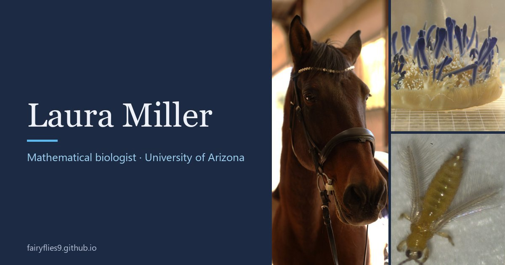
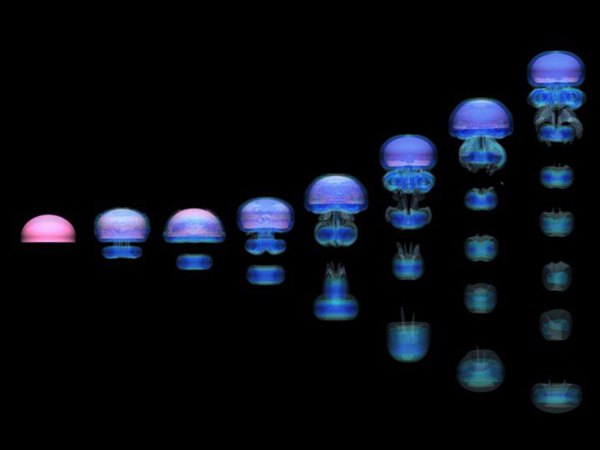
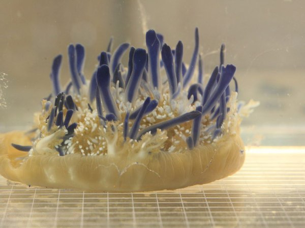
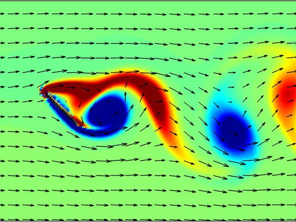
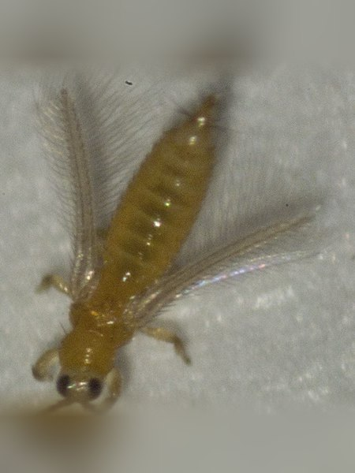
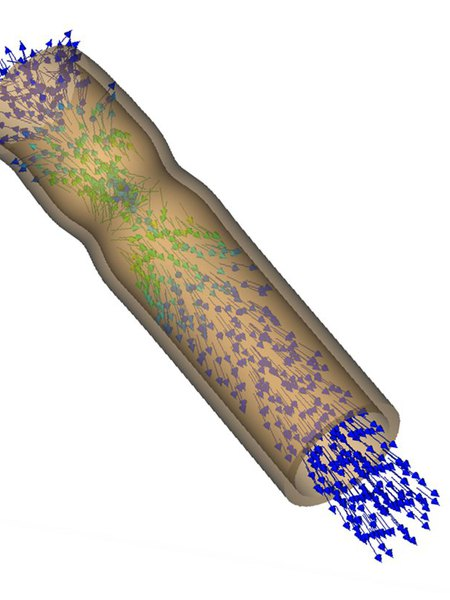
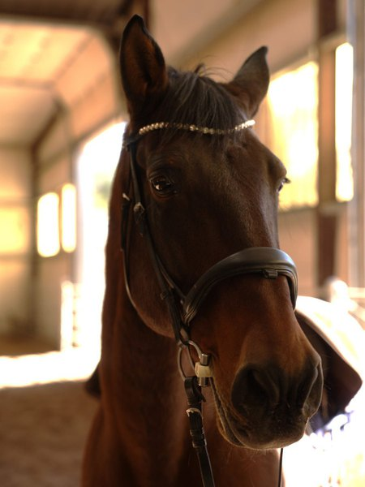

## Hi, I'm Laura Miller

I'm a professor of mathematics at the University of Arizona. My lab builds computer models of how animals move through air and water. We study jellyfish, soft corals, the smallest flying insects, ballooning spiders, and tubular hearts. Most of the code here uses the immersed boundary method, where a flexible body and the fluid around it move each other.

Lately I also study horses: how they move, and how their hearts respond to exercise. I founded [EquiPhysics](https://www.equiphysics.org), a small nonprofit in Sonoita, Arizona. Our horses are the teachers in our free math lessons and apps, which live at [github.com/equiphysics](https://github.com/equiphysics).

[Website](https://fairyflies9.github.io/) · [Google Scholar](https://scholar.google.com/citations?user=zrKC-PcAAAAJ&hl=en) · [ORCID](https://orcid.org/0000-0003-3707-9798) · [LinkedIn](https://www.linkedin.com/in/laura-miller-equiphysics/) · [EquiPhysics](https://www.equiphysics.org)

### Research in pictures

<table>
<tr>
<td width="33%"> A simulated jellyfish swimming</td>
<td width="33%"> Cassiopea, the upside-down jellyfish</td>
<td width="33%"> Vortices shed by a flapping wing</td>
</tr>
<tr>
<td width="33%"> A thrips, one of the smallest flying insects</td>
<td width="33%"> Blood cells in a simulated heart tube</td>
<td width="33%"> Duque. Our free gait and heart apps are built from his data.</td>
</tr>
</table>

### Start here

- **[Using-IB-Software](https://github.com/fairyflies9/Using-IB-Software)**: hands-on tutorials for IB2d, IBAMR (including IBFE), VisIt, and Planktos.
- **[Fluid-Dynamics-and-IBM-Theory](https://github.com/fairyflies9/Fluid-Dynamics-and-IBM-Theory)**: lecture slides on fluid dynamics, the immersed boundary method, solid mechanics, and turbulence.
- **[fluidlets](https://github.com/fairyflies9/fluidlets)**: regularized Stokeslets in Python for flows at very small scales, with worked examples and tutorial notebooks.
- **[Horse Gait Lab and Horse Heart Lab](https://equiphysics.github.io/web-apps/)**: free browser apps built from Duque's strides and heartbeats, on the EquiPhysics account.

### All my repositories

**Teaching**
- [Using-IB-Software](https://github.com/fairyflies9/Using-IB-Software): hands-on tutorials for immersed boundary software.
- [Fluid-Dynamics-and-IBM-Theory](https://github.com/fairyflies9/Fluid-Dynamics-and-IBM-Theory): the theory behind it, as lecture slides.

**Immersed boundary codes**
- [IB2d](https://github.com/fairyflies9/IB2d): my fork of Nick Battista's [IB2d](https://github.com/nickabattista/IB2d), an easy-to-use 2D immersed boundary code in MATLAB and Python with over 60 examples.
- [2D_IBM_MATLAB](https://github.com/fairyflies9/2D_IBM_MATLAB): an early (2015) MATLAB version of IB2d, with examples from rubber bands and beams to pumping heart tubes.
- [ib_matlab_2D-peskin](https://github.com/fairyflies9/ib_matlab_2D-peskin): Charlie Peskin's 2D immersed boundary code for MATLAB, with lecture notes.
- [ibmethod2D-isaacson](https://github.com/fairyflies9/ibmethod2D-isaacson): Sam Isaacson's 2D immersed boundary fluid solver for MATLAB, on a periodic square domain.

**Regularized Stokeslets**
- [fluidlets](https://github.com/fairyflies9/fluidlets): regularized Stokeslets in Python for flows where viscosity wins (cilia, glycocalyx brushes, swimming cells), with IB2d-style input files, ParaView output, and worked examples checked against published results.

**Models from our research**
- [JEB-CFD-Review](https://github.com/fairyflies9/JEB-CFD-Review): files for the review "Using computational fluid dynamics to understand fluid-organism interaction" (Santiago, Battista, and Miller): an IBFE model of a venous valve and a fog-desert cactus geometry.
- [Example-SuctionPumping-VP-AForce](https://github.com/fairyflies9/Example-SuctionPumping-VP-AForce): an IBAMR model of dynamic suction pumping in a 2D tubular heart, driven by actuators.
- [IBAMR-Examples](https://github.com/fairyflies9/IBAMR-Examples): IBAMR models of flow over a 3D glycocalyx and a 2D tube pump driven by actuators.
- [IBMSpiderProject](https://github.com/fairyflies9/IBMSpiderProject), [Example_spider_mass](https://github.com/fairyflies9/Example_spider_mass), and [Tethered-Spider-Release](https://github.com/fairyflies9/Tethered-Spider-Release): IBAMR models of ballooning spiders from the NIMBioS spider group, including a spider with mass and a tethered spider that is released into the flow.
- [matlab-Camuscle](https://github.com/fairyflies9/matlab-Camuscle): a MATLAB model of calcium-driven muscle force, with spike and square-wave stimulation and a force-frequency curve.
- [Planktos](https://github.com/fairyflies9/Planktos): my fork of Christopher Strickland's [Planktos](https://github.com/mountaindust/Planktos), agent-based models of plankton and tiny insects carried by fluid flow.

**My website and odds and ends**
- [fairyflies9.github.io](https://github.com/fairyflies9/fairyflies9.github.io): the source for my lab website.
- [9-ctenes](https://github.com/fairyflies9/9-ctenes): a placeholder for a model of nine oscillating plates, inspired by the comb plates of ctenophores.
- [planets](https://github.com/fairyflies9/planets): practice files from a Software Carpentry lesson on Git.
